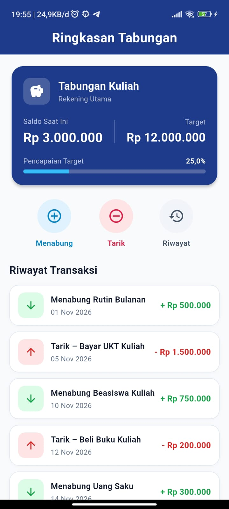
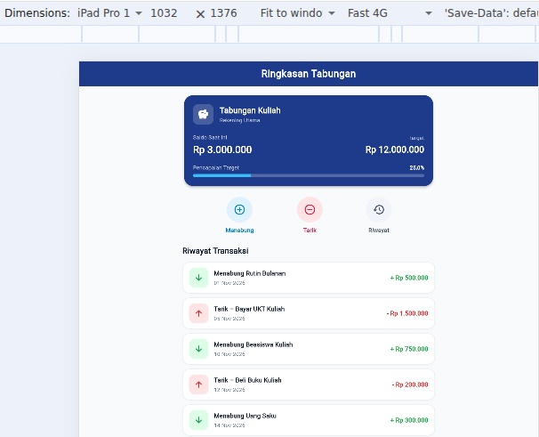

# TabungKu - Ringkasan Tabungan (Layout)

Tugas Minggu 3: Menyusun Layout dengan Widget Dasar Flutter  
Mata Kuliah: **Pemrograman Mobile**  
Sub-CPMK: **Sub-CPMK-1.1 Menyusun layout dengan widget dasar Flutter**  

---

## 👤 Informasi Mahasiswa
- **Nama**: Rizqi Bagas Wicaksono
- **NIM**: 20240801187
- **Kelas**: CR002
- **Program Studi**: Teknik Informatika


---

## 📱 Deskripsi Aplikasi
Aplikasi **TabungKu** menampilkan tata letak (*layout*) layar **Ringkasan Tabungan** yang dirancang menggunakan widget dasar Flutter tanpa paket pihak ketiga. Tata letak responsif dan bebas overflow pada layar smartphone potret maupun layar tablet.

### Komponen Utama Layout:
1. **AppBar**: Menampilkan judul halaman `"Ringkasan Tabungan"`.
2. **Kartu Ringkasan Tabungan (`Card`)**: Disusun dengan kombinasi `Column` dan `Row` yang menampilkan nama tabungan (*Tabungan Kuliah*), nominal saldo, serta target tabungan.
3. **Baris Kategori (`Row`)**: Tiga tombol/ikon penanda kategori transaksi (*Menabung*, *Tarik*, *Riwayat*).
4. **Daftar Transaksi Sederhana**: Menampilkan riwayat transaksi (judul, tanggal, dan nominal) menggunakan data statis (*hard-coded*).
5. **Pengaturan Layout**: Menggunakan `Padding`, `Container`, `SizedBox`, `SingleChildScrollView`, serta properti `mainAxisAlignment` dan `crossAxisAlignment` agar layout rapi dan responsif di berbagai ukuran layar.

---

## 📸 Tangkapan Layar (Screenshots)
Hasil tangkapan layar pada dua ukuran layar berbeda tersimpan di folder `docs/`:

| Ukuran Layar HP (Mobile Portrait) | Ukuran Layar Tablet / Desktop |
| :---: | :---: |
|  |  |

---

## 🚀 Cara Menjalankan Aplikasi

Pastikan Flutter SDK sudah terpasang di perangkat Anda.

1. **Clone repositori ini**:
   ```bash
   git clone <URL_REPOSITORI_ANDA>
   cd tabungku_layout
   ```

2. **Ambil dependensi proyek**:
   ```bash
   flutter pub get
   ```

3. **Jalankan aplikasi**:
   - Menjalankan pada emulator/perangkat yang terhubung:
     ```bash
     flutter run
     ```
   - Menjalankan di Chrome (Web) untuk pengujian cepat:
     ```bash
     flutter run -d chrome
     ```

4. **Menjalankan pengujian (widget test)**:
   ```bash
   flutter test
   ```
